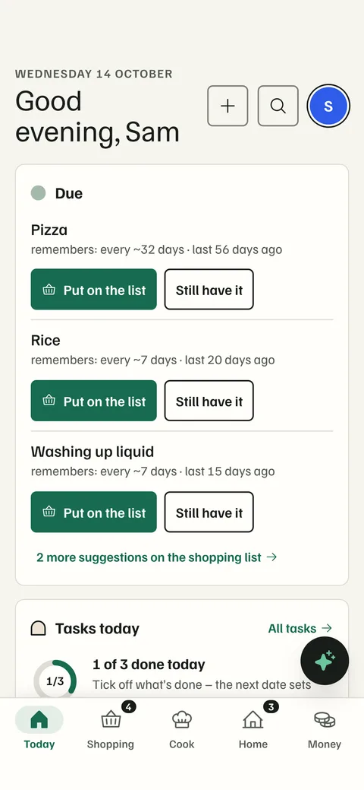
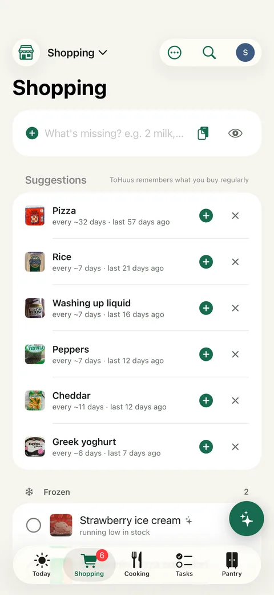
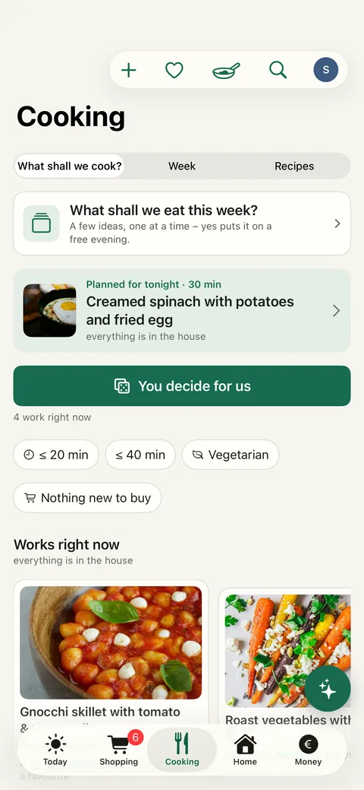
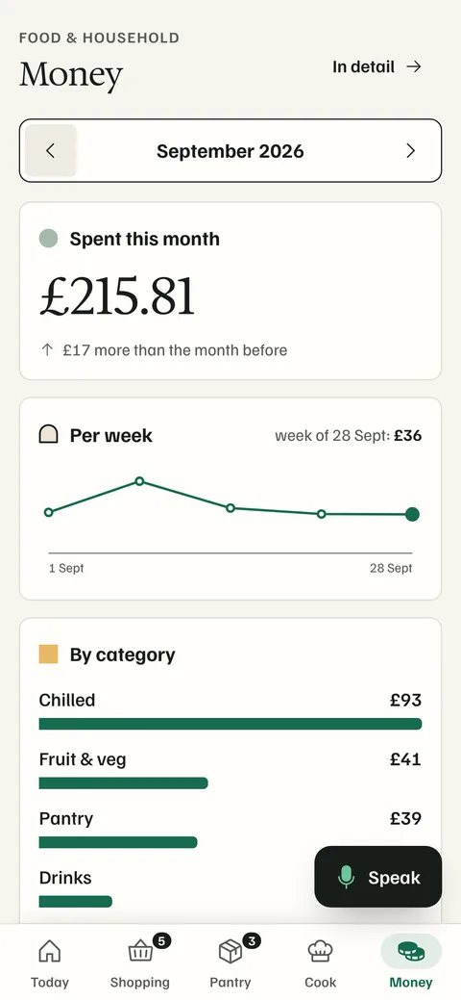
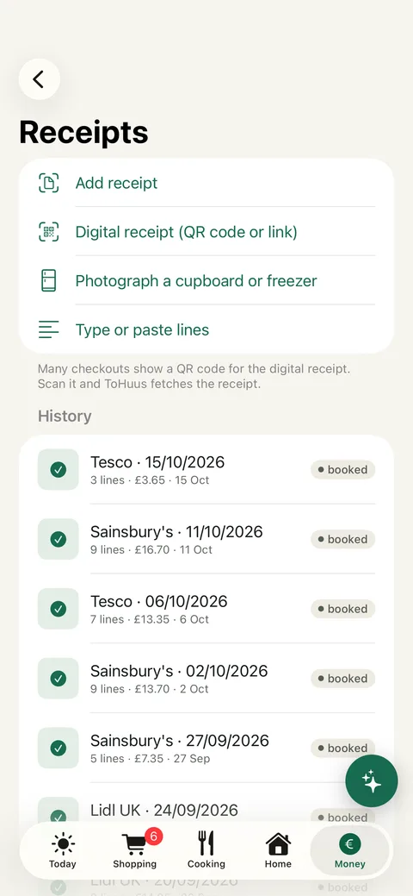
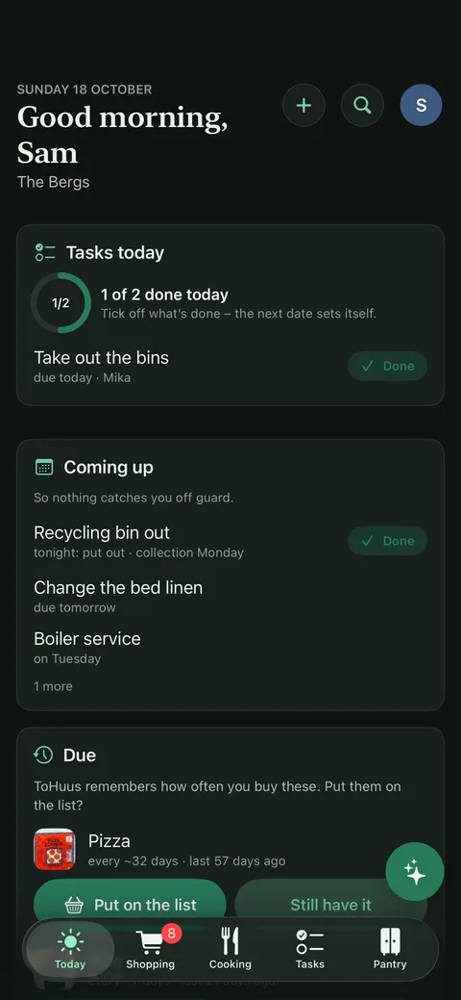

<p align="center">
  
</p>

<h1 align="center">ToHuus Hub</h1>

<p align="center"><a href="https://tohuus.heidrich-digital.de">Website</a> · <a href="https://tohuus.heidrich-digital.de/de/">Deutsch</a></p>

<p align="center">
  <b>Your home. Organized.</b><br/>
  When shopping goes digital, you should get something out of it too.
</p>

<p align="center">
  <a href="LICENSE"></a>
  
  
  <a href="https://github.com/tillheidrich/tohuus-hub-ha"></a>
</p>

---

## What it is

ToHuus Hub is a self-hosted household app for people who live alone, as a couple, as a family or in a shared flat. It keeps track of what is at home and where it is, plans what to eat, keeps the shopping list, and handles guests, trips and the small recurring jobs nobody remembers.

Your receipts, order confirmations and recipe links are already digital. ToHuus Hub reads them, so the stock fills itself and the spending overview builds itself. You do not have to type in your pantry. The point is to take some of the mental load off whoever usually keeps all of this in their head: what is running out, what we eat tonight, where the plasters are, when the water filter is due.

*To Huus* is Low German for "at home". The app speaks English and German.

It runs as one Docker container with a SQLite file. No account with us, no telemetry, no cloud service required.

## Screenshots

<table>
  <tr>
    <td></td>
    <td></td>
    <td></td>
  </tr>
  <tr>
    <td align="center">Today</td>
    <td align="center">Shopping</td>
    <td align="center">Cook</td>
  </tr>
  <tr>
    <td></td>
    <td></td>
    <td></td>
  </tr>
  <tr>
    <td align="center">Money</td>
    <td align="center">Receipts</td>
    <td align="center">Dark</td>
  </tr>
</table>

The screenshots show a demo household with invented names and receipts. German versions are in [`site/assets/shots/de/`](site/assets/shots/de/).

## Features

A complete reference with where each feature sits in the app is in [docs/features.md](docs/features.md). The short version:

### Everyday and shopping

- **Today**: one screen with what expires, what is empty or low, tonight's meal, what to eat first, due care tasks, kid wishes and pending imports.
- **Shopping list** that syncs live between phones. Low items land on it by themselves. Ticking an item books it into stock.
- **Store mode**: grouped by aisle, the order is learned per store, works offline, "I'll get it" claims, natural-language quick add ("2 l milk, bread").
- **Discreet items**: mark an entry "discreet" and everyone else sees a neutral placeholder such as "Drugstore item", or "only me" so nobody else sees it at all. The real name never reaches Home Assistant, Telegram, displays, printed lists, guest links or AI assistants.
- **Share into the app**: installed as a web app on Android or desktop, ToHuus Hub appears in the share menu. Share a WhatsApp list, a recipe link or a receipt photo. On iPhone, a Shortcut with a personal key does the same for the shopping list.
- **Treats („Bring mir was“)**: do each other a good turn. Whoever is stuck with bedtime, ill in bed or working late asks for "vanilla ice cream, please" or "tea with honey" – the others get a push with "I'll bring it" or "Can't right now". No points, no ranking, just a private thanks.
- **Home care**: water filter, smoke detectors, descaling, tyres, passport expiry. Templates, reminders, one tap to mark done.
- **Receipt-style tickets** for shopping lists, kitchen orders, care tasks and recipe cards, printed on an ESC/POS thermal printer or sent to Telegram, Matrix, Gotify or e-mail.
- **Kitchen and wall displays** that also run on old tablets, plus a PNG for e-ink frames.

### Cooking

- **What do we eat today?**: what works with what is at home, what lacks one thing (with "take rice instead"), leftovers first, quick dishes, and a button that just decides.
- **Week plan** with recipes or free entries ("pizza"), auto-fill from stock, and one tap to put the whole week's missing ingredients on the list.
- **Rotation**: save weeks as templates and rotate between up to six of them. Filled days, days marked "away" or "eating out", and dishes you had recently are left alone.
- **Family votes**: "who wants what?". Everyone says no, yes or "super" on their own phone, or one phone goes round the table (kids vote here without a login).
- **Servings per plan entry**: Bolognese for 6 instead of 4 scales the recipe, the shopping and what gets booked out after cooking.
- **House versions**: your own way of cooking a recipe (rice instead of potatoes, no coriander) without touching the original, plus house-wide swap rules ("oat milk instead of milk").
- **Ratings and favourites** per person. Likes, dislikes and allergies nudge suggestions; a dish with an allergen is never auto-planned.
- **Recipe import** from any page with schema.org data, from photos and text (with a vision model), from other apps (Mealie, Tandoor, Paprika, Nextcloud Cookbook, KitchenOwl, Grocy, CSV), from TheMealDB, from any AI chat with a ready-made prompt, and the Cookidoo week plan through Home Assistant. See [docs/recipes-import.md](docs/recipes-import.md).

### Stock

- **Only what runs out**: start by tracking the few things that regularly run out. Switch to everything later without losing anything.
- **Coarse fill levels** (full, half, low, empty) for fruit, bread and the like. Counted items for packets and bottles. Some things are not counted at all.
- **Where is what**: an exact spot per item ("left shelf, top compartment") and a direction per room. Search "plaster" and get the answer. Works for things you never count, like the fuse box.
- **Keeping it true**: quick check per room (right, less, empty, gone), opened and frozen items with their own shelf life, best-before versus use-by, a monthly waste card.
- **Leftovers and freezer labels**: put a box away in two taps. It gets a short code and a QR label (A4 sticker sheet, label printer or a picture to share). Scanning it opens eat, thaw, throw away or plan.
- **Barcodes** with product name and photo from Open Food Facts.

### Receipts and spending

- **Supported**: REWE pickup notices and eBons (reconciled with each other), a generic German parser (Lidl, Aldi, Edeka, Netto, Kaufland, Penny, dm, Rossmann and more), UK, US and Swedish receipts, digital receipts behind a QR link, an IMAP inbox for forwarded receipts, photos with a vision model or through your AI assistant. Full table in [docs/receipts.md](docs/receipts.md).
- **Learns from corrections**: fix a line once in the review and the rule applies to the next receipt from that store. Rules are visible and can be deleted.
- **Help improve recognition** without giving away private data: the app builds an anonymised copy of a receipt (no address, card, loyalty or TSE numbers, dates moved to the 1st of the month) that you can check, download or attach to an issue. Nothing is sent automatically.
- **Spending** per week, month, year or all time, by store and category, budgets with a calm forecast, manual expenses, items you leave out of the statistics, CSV export.

### Family and guests

- **Profile pictures**: a photo, a drawn animal or initials.
- **Kids without a login**: a paired kid tablet shows pictures of what a child may wish for. Every wish waits for a parent.
- **Permanent guests** (the aunt who is often there, a regular babysitter) sign in with their own account at one of four levels, with temporary overrides. See [docs/guests-and-permissions.md](docs/guests-and-permissions.md).
- **Guests and party mode**: the same mechanics for visitors, the babysitter and grandparents – a link or QR code lets guests ask for what is actually there. A party adds a TV board with a join QR, a kitchen view and an automatic end.
- **Menu editor**: decide what the household, guests and parties can ask for, from stock or menu-only (tap water, cappuccino), with optional ingredients that are booked out per serving.
- **Babysitter link**: read-only "where is what" for chosen places, with a note (emergency numbers, bedtime) and an optional list of voice commands the sitter may use. Locks, alarms, cameras and garage doors are never on that list.

### Trips

- **Away mode**: before a trip, use up what would go off, a packing list (items from stock are booked out and back), a short checklist. During it, notifications stay quiet and automatic shopping suggestions pause, an optional "holiday kitchen" has its own meals and list, and a house-sitter link ends the day after you return. Afterwards there is a welcome-home list and a check of what expired.

### Home Assistant

- A native integration from HACS ([tillheidrich/tohuus-hub-ha](https://github.com/tillheidrich/tohuus-hub-ha)): shopping list as a to-do list (works with Assist), meal plan and care tasks as calendars, sensors, actions for automations, events on the bus, display images, two ready-made dashboards, live updates.
- **Two-way per topic**: shopping list with an HA to-do list (Bring!, Todoist, local), meal plan with an HA calendar, due care tasks to a to-do list, presence from HA person entities, notifications through the companion app per member, NFC tags as quick actions.
- Full reference: [docs/home-assistant.md](docs/home-assistant.md).

### Notifications

Web Push to installed phones (with action buttons), Telegram (two-way: send "milk" to the bot and it is on the list), Gotify, Matrix, ntfy, e-mail with a daily digest, a Home Assistant webhook or any webhook. A matrix per event decides which channel gets what. See [docs/notifications.md](docs/notifications.md).

### AI assistants (MCP)

A built-in MCP server with **106 tools** for Claude, ChatGPT and other MCP clients: stock, shopping, recipes and imports, week plan, votes and rotation, leftovers, trips, spending, receipts, the order menu, Home Assistant status and more. Send a photo of a receipt to your assistant and say "put this into ToHuus Hub". Purchases land in the review queue unless the assistant is told to book them directly. Tool list: [docs/mcp.md](docs/mcp.md).

### Look, language and region

- Light and dark mode. An admin sets the household default (light, dark or like the device) and can let every member choose their own.
- One look ("Dutch Detail": green and black, Familjen Grotesk and Hedvig Letters), light and dark, chosen for everyone by an admin or per person if allowed.
- English and German UI, notifications and demo data; regions (currency, units, receipts) are separate, Sweden included. Adding a language is one dictionary file per area.
- Regions (DE, AT, CH, GB, IE, US, SE, DK, NO, NL) set currency, number and date format, units shown in recipes, first day of the week and which receipts and stores to expect, independent of the UI language.

### Sign-in

Password with optional two-step code (TOTP), one-time e-mail links, passkeys (Face ID, Touch ID, Windows Hello), single sign-on with OpenID Connect (Authentik, Keycloak, Forgejo, Google and others), a PIN switch on a shared family tablet, a device list with "sign out others", alerts on new sign-ins. See [docs/auth.md](docs/auth.md).

### Your data

- JSON export of every household table, without credentials.
- Nightly backups with rotation, manual backups, optional off-site copy to WebDAV or Nextcloud, restore from a backup or an export.
- An automatic backup before any database migration runs.
- Demo data you can load and remove precisely, a guided tour, and "start over" for chosen areas (with a backup first).

Details: [docs/data-and-reset.md](docs/data-and-reset.md).

## How it compares

| | ToHuus Hub | Grocy | KitchenOwl | Mealie | Bring! |
|---|---|---|---|---|---|
| Self-hosted, open source | ✅ AGPL | ✅ MIT | ✅ AGPL | ✅ AGPL | no |
| Stock comes in via receipts, order PDFs, e-mail | ✅ | no (manual, barcode) | no | no | no |
| Coarse fill levels instead of exact counts | ✅ | partly | no | no | no |
| Where-is-what with exact spot and babysitter link | ✅ | no | no | no | no |
| Shopping list with store order, offline, live sync | ✅ | basic | ✅ | basic | ✅ |
| Recipes, week plan, "what can we cook from stock" | ✅ | ✅ | ✅ | ✅ (strong recipe scraper) | recipes only |
| Guest bar and party mode with TV board | ✅ | no | no | no | no |
| Kid mode with parent approval | ✅ | no | no | no | no |
| MCP server for AI assistants | ✅ | no | no | no | no |
| Home Assistant | HACS integration, two-way topics | HACS integration | not checked | official integration (calendar, to-do) | official integration (to-do) |

Comparison as of October 2026, from public docs and our research notes in [`docs/research/`](docs/research/). Corrections welcome.

## Install

```bash
git clone https://github.com/tillheidrich/tohuus-hub.git && cd tohuus-hub
cp .env.example .env        # set BASE_URL, ADMIN_NAME, ADMIN_PASSWORD
docker compose up -d --build
```

The compose file can also pull the prebuilt image `ghcr.io/tillheidrich/tohuus-hub:latest`. Data lives in `./data` (mounted at `/data`). Open `http://localhost:8080`.

On the first start the admin chooses "start empty" or "explore with demo data". Demo rows are marked and can be removed in one go under *Settings › Data & backups*. Put the app behind HTTPS; passkeys and the share target need it.

### Environment variables

Every variable the server reads. Only `BASE_URL` and the admin account matter for most installs.

| Variable | Default | Meaning |
|---|---|---|
| `BASE_URL` | `http://localhost:8080` | Public URL. Used in links, notifications, guest links, MCP addresses and as the passkey domain. |
| `PORT` | `8080` | Port the server listens on. |
| `DATA_DIR` | `./data` (`/data` in Docker) | Where the database, images, imports and backups are stored. |
| `DB_ENCRYPTION_KEY` | none | Encrypts the database at rest (32 random bytes, `openssl rand -base64 32`, or a long passphrase). Keep it outside the data volume – without it the data cannot be read. An existing plain database is converted on the next start. |
| `STORAGE_QUOTA_MB` | `0` | Storage limit in MB for photos, receipt files and the database (`0` = unlimited). |
| `ADMIN_NAME` | `Admin` | First account, created when there are no users yet. |
| `ADMIN_PASSWORD` | random | Password for that account. If empty, a random one is printed to the log once. |
| `LANGUAGE` | `en` | UI language on first start: `en` or `de`. Changeable under *Settings › Household*. |
| `REGION` | from `LANGUAGE` | Where the household shops on first start: `DE`, `AT`, `CH`, `GB`, `IE`, `US`, `SE`, `DK`, `NO`, `NL`. Default: `de` → DE, `en` → GB. |
| `BRAND` | none | No longer used (there is only one look since 2026-10-11). Old values are ignored. |
| `SEED_DEMO` | `false` | `true` loads the demo household once, on a start when there are no products yet. Demo rows are marked and removable. |
| `TZ` | `Europe/Berlin` | Time zone for best-before dates, the daily digest and the nightly backup. |
| `TRUST_PROXY_HOPS` | `1` | Number of reverse proxies in front, for rate limiting by client IP. |
| `AI_API_KEY` | none | Turns on the assistant, voice and receipt photos. With only this set, ToHuus uses OpenRouter pinned to Mistral (EU, no fallbacks, no data collection). See [docs/assistant.md](docs/assistant.md). |
| `AI_BASE_URL` | `https://openrouter.ai/api/v1` | Any OpenAI-compatible endpoint (Mistral, Ollama, vLLM …). The provider pin is only sent to OpenRouter. |
| `AI_MODEL_TEXT` / `AI_MODEL_VISION` | `mistralai/mistral-small-2603` | Assistant and photo models. |
| `AI_MODEL_VISION_HARD` | `mistralai/mistral-large-4-0` | Second try for receipts whose lines don't add up. |
| `AI_MODEL_AUDIO` | `mistralai/voxtral-small-24b-2507` | Speech to text for the assistant's microphone. |
| `VISION_BASE_URL` / `VISION_API_KEY` / `VISION_MODEL` | none | Older setting for photo and text imports; used when no `AI_*` is set. |
| `SMTP_HOST` | none | Mail server. With `SMTP_FROM` it enables e-mail notifications, the digest, sign-in links and password reset. |
| `SMTP_PORT` | `587` | Mail server port. |
| `SMTP_SECURE` | `false` | `true` for implicit TLS (port 465). |
| `SMTP_USER` / `SMTP_PASSWORD` | none | Mail server login. |
| `SMTP_FROM` | none | Sender address, e.g. `ToHuus Hub <home@example.org>`. |
| `OIDC_ISSUER` / `OIDC_CLIENT_ID` / `OIDC_CLIENT_SECRET` | none | Single sign-on. Only seeds *Settings › Members › Single sign-on* on the first start; the UI wins afterwards. |
| `OIDC_BUTTON_LABEL` | none | Text on the SSO button. |
| `OIDC_SCOPES` | `openid email profile` | Scopes requested from the provider. |
| `OIDC_AUTO_CREATE` | `false` | `true` creates a member on first SSO sign-in. |
| `AUTH_BREAK_GLASS` | `false` | Locked out? `true` allows passwords for everyone and suspends the two-step requirement until you remove it. |
| `MCP_PATH_SECRET` | none | Optional fixed MCP path `/mcp/<secret>`. Tokens created in the app work without it. |
| `OFF_ENABLED` | `true` | `false` turns off Open Food Facts lookups (product photos, barcodes). |
| `OFF_USER_AGENT` | `ToHuusHub/0.1 (…)` | User agent for Open Food Facts. Please put a contact in it. |
| `TELEGRAM_API_URL` | `https://api.telegram.org` | A self-hosted Telegram Bot API server, if you run one. |
| `RECEIPT_FEEDBACK_MAIL` | none | Address for the "mail" button when someone shares an anonymised receipt. Nothing is sent automatically. |
| `APP_SECRET` | none | Read but currently unused. |

Web Push keys are generated on first use and stored in the database.

### Connect an AI assistant (MCP)

1. *Settings › Access & AI › New access › AI assistant*.
2. Copy the MCP address (`https://your-host/mcp/sw_…`).
3. Claude: *Settings › Connectors › Add custom connector*. ChatGPT: *Settings › Connectors* (developer mode). Authentication: none. The token is in the URL, so treat the URL like a password and revoke it in ToHuus Hub if it leaks. `Authorization: Bearer` on `/mcp` works too.

### Connect Home Assistant

Install **ToHuus Hub** from HACS (add `https://github.com/tillheidrich/tohuus-hub-ha` as a custom repository), create an access under *Settings › Access & AI › New access › Home Assistant*, then add the integration in Home Assistant with your ToHuus Hub address and the token. Details and the YAML fallback: [docs/home-assistant.md](docs/home-assistant.md).

## Privacy and security

- One household per instance. Everything stays in one SQLite file on your server.
- No telemetry. Outgoing requests only go where you point them: Open Food Facts, your vision endpoint, your mail server, Home Assistant, Telegram and the other channels you configure, recipe and receipt links you import.
- Passwords are hashed with scrypt. Sessions are random tokens stored as hashes, long-lived, httpOnly, and listed per device. API tokens, guest links and display links are stored as hashes too.
- Sign-in is rate-limited. Cookie-authenticated writes from other origins are rejected. A strict Content Security Policy is set.
- Fetches of user-supplied URLs block private and internal networks, limit redirects, size and time.
- Tokens are scoped: an "AI assistant" token only reaches MCP, a "Home Assistant" token only `/api/ha/*` and `/api/events`.
- Permanent guests are limited by an allowlist on the server, not just hidden menu items. Guest links only expose the bar, chosen places (names, no quantities) or adding to the shopping list.
- Discreet and private shopping items keep only a placeholder in the shared table, so every integration sees the placeholder at worst.
- The JSON export skips sessions, tokens and push subscriptions, and drops every setting field whose name contains `token`, `passw`, `secret`, `api_key`, `webhook` or `ntfy`. Backups are full database copies, so keep them, and the WebDAV folder they go to, as private as the server.

The security model in more detail: [docs/architecture.md](docs/architecture.md#security-model).

## Development

```bash
npm install
npm run dev          # API on :8080 (tsx watch)
npm run dev:web      # Vite on :5173, proxies /api
npm test             # vitest
npm run typecheck    # tsc
npm run build        # web → dist/web, server → dist/server.mjs
```

Stack: Node 22, Express 5, better-sqlite3, sharp, zod, the MCP TypeScript SDK. Web: React 19, React Router, TanStack Query, vanilla CSS with design tokens, Phosphor icons, Familjen Grotesk and Hedvig Letters Sans/Serif (self-hosted). Barcode scanning uses `barcode-detector` with the zxing WASM file served locally. PDFs are read with `pdftotext` from poppler (in the Docker image).

The test suite has 455 tests in 32 files (October 2026). CI runs tests and the build on every push.

### How an area is structured

Features are grouped into areas (party, fresh, shop, labels, away, plan2, recipes2, people, ha2, menu and so on). An area usually has:

- `server/routes/<area>.ts`: an Express router, mounted under `/api` in `server/index.ts`.
- `server/lib/<area>.ts`: the logic, plus its tables through a named migration.
- `server/mcp/tools-<area>.ts`: MCP tools, registered in `server/mcp/server.ts`.
- `server/locales/de-<area>.ts` and `web/src/locales/de/<area>.ts`: translations keyed by the English source text.
- `web/src/pages/…`: the screens.
- `test/<area>.test.ts`.

Schema changes go through **named migrations**: `migrate('labels-2', sql)` runs exactly once. Never edit SQL that has shipped; add a new name. Before the first pending migration runs on an existing household, the database is copied into the backups folder.

More: [docs/architecture.md](docs/architecture.md). Design decisions and tokens: [docs/design/2026-10-11-nordic-direction.md](docs/design/2026-10-11-nordic-direction.md). Research behind the roadmap: [docs/research/](docs/research/). Changes: [CHANGELOG.md](CHANGELOG.md).

## Contributing

Issues and pull requests are welcome. Receipt parsers for more stores are especially useful: see `server/importers/` and the synthetic fixtures in `test/fixtures/`. If you send a real receipt, use *Help improve recognition* in the import review so it is anonymised first.

For a pull request: add tests next to the area you change, keep migrations append-only, add the English string in code and its German translation in the locale files, and run `npm test` and `npm run typecheck`.

ToHuus Hub is written by its maintainer together with AI coding agents (Claude). Every feature lands with tests and is used daily by a real family. If something looks off, open an issue.

## License

AGPL-3.0-or-later. See [LICENSE](LICENSE). The Home Assistant integration in [`ha-integration/`](ha-integration/) is MIT-licensed.

## Credits

- Product data and images partly from [Open Food Facts](https://openfoodfacts.org) (database ODbL, images CC BY-SA), shown with attribution in the app.
- Demo recipe photos from [Unsplash](https://unsplash.com) under the Unsplash License. Photographers are listed in [server/assets/demo-recipes/CREDITS.md](server/assets/demo-recipes/CREDITS.md).
- Recipe search uses [TheMealDB](https://www.themealdb.com) (free public API).
- Fonts: Familjen Grotesk and Hedvig Letters (SIL Open Font License, licence texts in web/public/fonts). Icons: Phosphor (MIT).
- ToHuus Hub is not affiliated with REWE, Vorwerk, Thermomix, Cookidoo, HelloFresh, Bring!, Mealie or any store named here. Their names only describe compatible formats.

Built by [Till Heidrich](https://github.com/tillheidrich), with a lot of help from Claude.
