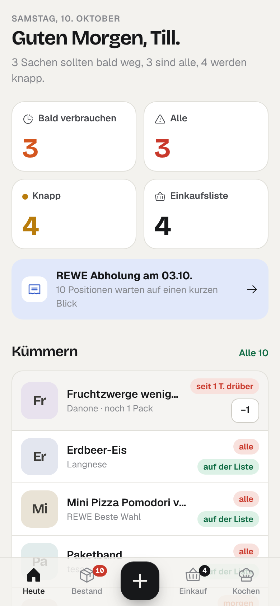
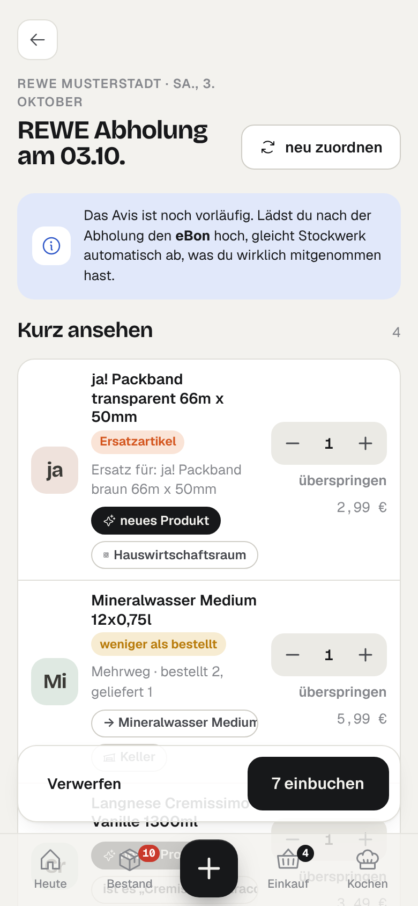
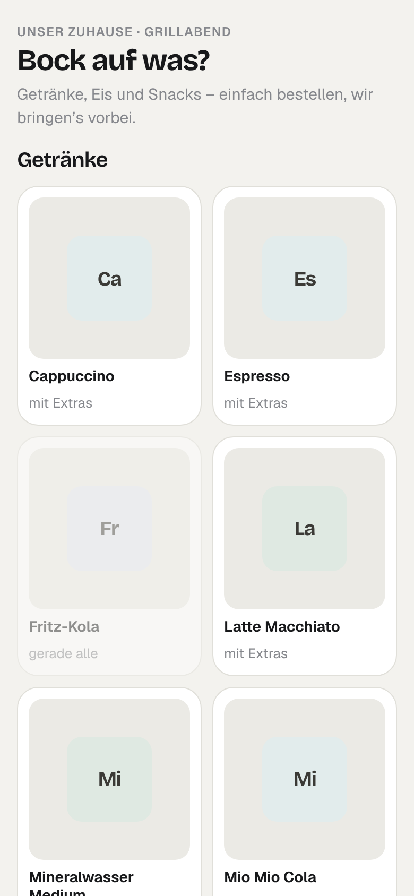

<p align="center">
  
</p>

<h1 align="center">Stockwerk</h1>

<p align="center">
  <b>What's in the house. At a glance.</b><br/>
  Self-hosted household stock, shopping list and recipes — with a guest bar, Home Assistant and an MCP server built in.
</p>

<p align="center">
  <a href="LICENSE"></a>
  
  
  
</p>

<p align="center">
  
  
  
</p>

---

## Why another pantry app?

Most inventory apps die the same death: somebody has to type everything in, nobody does, the data drifts, the app gets deleted. Stockwerk is built around the opposite idea — **stock comes in through what you already have**:

- **Grocery receipts and orders.** Upload the REWE pickup/delivery notice (*Abholavis*) and the digital receipt (*eBon*). Stockwerk reads both, flags substitutions and missing items, and — the part nobody else does — **reconciles the order with the receipt**, so whatever you handed back at pickup doesn't end up in your stock.
- **Photos.** Snap a receipt, the freezer drawer or a recipe card. With a vision model configured, Stockwerk reads it; without one, send the photo to Claude or ChatGPT and let the assistant file it via MCP.
- **Barcodes.** Scan with the phone camera; product name and photo come from Open Food Facts. Pick an image once and it sticks.
- **Coarse where coarse is enough.** Fruit, vegetables and bread are tracked as *full · half · low · empty*. Packets, bottles and cans are counted. Some things (coffee from the machine) aren't counted at all.

And because the honest answer to *"what should we cook?"* depends on what's actually there, Stockwerk ranks your recipes by stock, expiry dates, favourites and how long ago you last made them — with a swipe deck for the indecisive.

## Features

| | |
|---|---|
| **Today** | One screen: what expires, what's empty, what's low, the shopping list, tonight's best recipe, pending imports and guest orders. |
| **Floors** | Fridge, freezer, pantry, cellar, bathroom, utility room — every location at a glance, with health meter and product photos. |
| **Stock** | Search, filter by location and status, +/- right in the list, best-before per batch, FEFO consumption, move between locations, history and weekly usage. |
| **Shopping list** | Live-synced between phones. Low items land on it automatically; tick an item and it goes straight into stock. Share as text. |
| **Imports** | REWE *Abholavis* / *Lieferavis* / *eBon* parsers (deterministic, tested), digital receipts via QR link, photos, pasted text. Everything goes through a review step: substitutions, refused items, new products, target location. Receipt abbreviations are learned per product. |
| **Recipes** | Import from any site with schema.org data (Cookidoo: title, image, ingredients), from photos (HelloFresh cards etc.) or text. Thermomix steps with time / temperature / speed. Cooking log, "used up" after cooking, missing ingredients to the shopping list. |
| **Guest bar** | Share a link or QR code: guests order drinks, ice cream and snacks from what's actually in stock — with options like oat milk or toppings. You get a push, accept, serve; stock is deducted. Babysitter links can show selected locations read-only. |
| **Notifications** | Home Assistant webhook, ntfy, any webhook, e-mail. Low / empty / expiring, import waiting, new guest order, daily digest. |
| **Home Assistant** | REST summary endpoint for dashboard sensors, action endpoint for `rest_command`, generated package with an actionable iOS push ("put on shopping list"). |
| **MCP** | 16 focused tools for Claude, ChatGPT and other MCP clients: overview, search, update stock, used up, record purchase (with review), shopping list, suggest meals, save recipe, log cooked … |
| **Language** | German UI (the household it was built for), English docs. UI translations are welcome. |
| **Your data** | SQLite file, JSON export, no telemetry, no cloud dependency. Runs on a NAS or a small VPS (~60 MB RAM). |

## Quick start

```bash
git clone https://github.com/tillheidrich/stockwerk.git && cd stockwerk
cp .env.example .env        # set BASE_URL, ADMIN_NAME, ADMIN_PASSWORD
docker compose up -d --build
```

Open `http://localhost:8080`. Want to look around first? Set `SEED_DEMO=true` before the first start for a demo household (freezer, cellar, drinks bar, recipes).

### Configuration

| Variable | Default | |
|---|---|---|
| `BASE_URL` | `http://localhost:8080` | Public URL — used for links in notifications, guest links and MCP. |
| `ADMIN_NAME` / `ADMIN_PASSWORD` | `Admin` / random | First account, created on first start. More members in *Settings*. |
| `SEED_DEMO` | `false` | Demo data on first start. |
| `VISION_BASE_URL` / `VISION_API_KEY` / `VISION_MODEL` | – | Optional. Any OpenAI-compatible chat endpoint with image input (Mistral, Ollama + a VL model, vLLM, OpenRouter …). Enables photo imports. |
| `SMTP_*` | – | Optional e-mail notifications and daily digest. |
| `MCP_PATH_SECRET` | – | Optional fixed MCP path. Tokens created in the app work without it. |
| `TRUST_PROXY_HOPS` | `1` | Number of reverse proxies in front (for rate limiting by IP). |
| `TZ` | `Europe/Berlin` | Used for best-before dates and the daily digest. |

## Connect Claude or ChatGPT (MCP)

1. *Settings → Access & AI → New access → "AI assistant"*.
2. Copy the MCP URL (`https://your-host/mcp/sw_…`).
3. Claude: *Settings → Connectors → Add custom connector*. ChatGPT: *Settings → Connectors* (developer mode). Authentication: none — the token is in the URL, so treat the URL like a password and revoke it in Stockwerk if it leaks. Bearer auth on `/mcp` works too.

Then, from your phone: send a photo of a receipt or a HelloFresh card and say *"put this into Stockwerk"*. Purchases land in the review queue by default, recipes are saved directly.

## Home Assistant

*Settings → Access & AI → New access → "Home Assistant"* generates a ready-to-paste package with:

- REST sensors: low/empty count (with attributes), expiring count, shopping list, tonight's recipe idea;
- `rest_command.stockwerk_action` (`add_shopping`, `consume`, `used_up`, `restock`);
- an automation turning Stockwerk webhooks into phone notifications with an *"Auf die Einkaufsliste"* button.

Put the webhook URL into *Settings → Notifications*.

## Supported documents

| Source | Status |
|---|---|
| REWE Abholavis / Lieferavis (PDF) | ✅ substitutions, unavailable, reduced quantities, weighed goods, deposits |
| REWE eBon (PDF) | ✅ quantities, weights, deposit/returns; matched to the order by order number or market + day |
| Digital receipts via QR link | ✅ PDF or HTML behind the link |
| Any receipt / shelf / recipe photo | ✅ with a vision model, or via your MCP assistant |
| Purchase history CSV (e.g. REWE GDPR export) | ✅ builds the product catalogue and receipt aliases |

Parsers for other shops are welcome — see `server/importers/` and the fixtures in `test/fixtures/`.

## Development

```bash
npm install
npm run dev          # API on :8080 (tsx watch)
npm run dev:web      # Vite on :5173 with proxy
npm test             # parser + matching tests
npm run build        # web → dist/web, server → dist/server.mjs
```

Stack: Node 22, Express 5, better-sqlite3, sharp, MCP TypeScript SDK; React 19, TanStack Query, vanilla CSS, Phosphor icons, Geist + Bricolage Grotesque (self-hosted). Barcode scanning via `barcode-detector` (zxing-wasm, served locally).

## Security notes

Stockwerk is meant for one household. Accounts use scrypt-hashed passwords and long-lived httpOnly sessions; logins are rate-limited; state-changing requests from other origins are rejected; outgoing fetches for user-supplied URLs block private networks. Guest links only expose the bar, selected locations (names, no quantities) or adding to the shopping list. Put it behind HTTPS.

## Credits & legal

Product data and images partly from [Open Food Facts](https://openfoodfacts.org) (database: ODbL, images: CC BY-SA) — shown with attribution in the app. Stockwerk is not affiliated with REWE, Vorwerk/Thermomix, Cookidoo or HelloFresh; their names are used only to describe compatible document formats.

Licensed under **AGPL-3.0-or-later**. Built by [Till Heidrich](https://github.com/tillheidrich) — with a lot of help from Claude.
