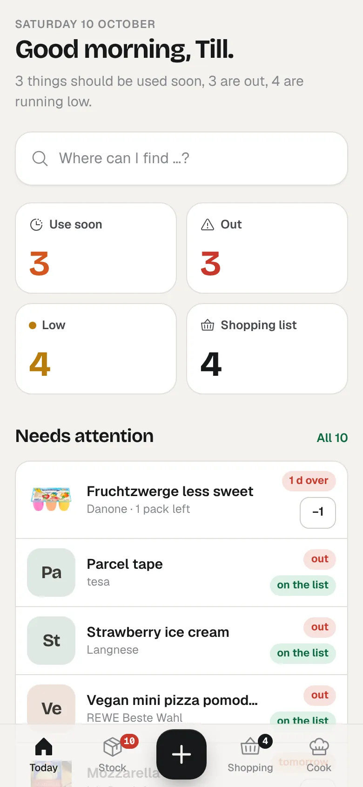
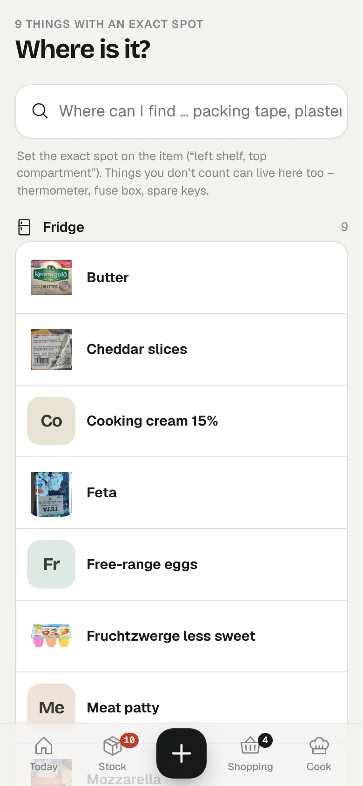
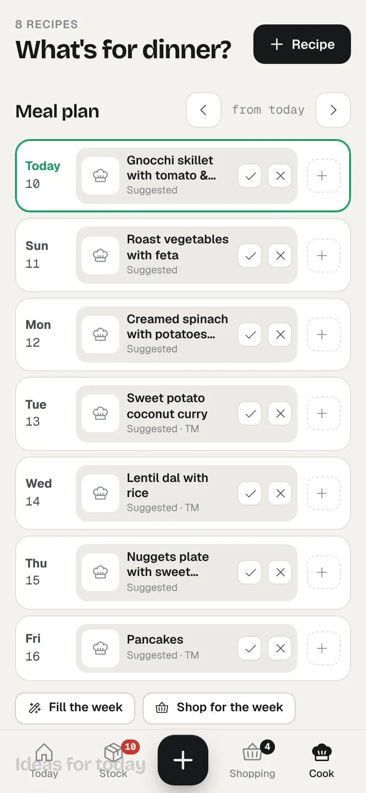

<p align="center">
  
</p>

<h1 align="center">ToHuus Hub</h1>

<p align="center"><a href="https://tohuus.heidrich-digital.de">Website</a> · <a href="https://tohuus.heidrich-digital.de/de/">Deutsch</a></p>

<p align="center">
  <b>Your home. Organized.</b><br/>
  Open-source home management: what's in the house, where it is, what's for dinner — with a week plan, a guest bar, Home Assistant and an MCP server built in.
</p>

<p align="center">
  <a href="LICENSE"></a>
  
  
  <a href="https://github.com/tillheidrich/tohuus-hub-ha"></a>
</p>

<p align="center">
  
  
  
</p>

---

> *To Huus* is Low German for "at home". The app speaks English and German out of the box (Settings → Household → Language); more languages are a single file each — see `web/src/locales/`.

## Why another pantry app?

Most inventory apps die the same death: somebody has to type everything in, nobody does, the data drifts, the app gets deleted. ToHuus Hub is built around the opposite idea — **stock comes in through what you already have**:

- **Grocery receipts and orders.** Upload the REWE pickup/delivery notice (*Abholavis*) and the digital receipt (*eBon*). ToHuus Hub reads both, flags substitutions and missing items, and — the part nobody else does — **reconciles the order with the receipt**, so whatever you handed back at pickup doesn't end up in your stock.
- **Photos.** Snap a receipt, the freezer drawer or a recipe card. With a vision model configured, ToHuus Hub reads it; without one, send the photo to Claude or ChatGPT and let the assistant file it via MCP.
- **Barcodes.** Scan with the phone camera; product name and photo come from Open Food Facts. Pick an image once and it sticks.
- **Coarse where coarse is enough.** Fruit, vegetables and bread are tracked as *full · half · low · empty*. Packets, bottles and cans are counted. Some things (coffee from the machine) aren't counted at all.

And because the honest answer to *"what should we cook?"* depends on what's actually there, ToHuus Hub ranks your recipes by stock, expiry dates, favourites and how long ago you last made them — with a swipe deck for the indecisive.

## Features

| | |
|---|---|
| **Today** | One screen: what expires, what's empty, what's low, the shopping list, tonight's best recipe, pending imports and guest orders. |
| **Floors** | Fridge, freezer, pantry, cellar, bathroom, utility room — every location at a glance, with health meter and product photos. |
| **Stock** | Search, filter by location and status, +/- right in the list, best-before per batch, FEFO consumption, move between locations, history and weekly usage. |
| **Shopping list** | Live-synced between phones. Low items land on it automatically; tick an item and it goes straight into stock. Share as text. |
| **Imports** | REWE *Abholavis* / *Lieferavis* / *eBon* parsers (deterministic, tested), digital receipts via QR link, photos, pasted text. Everything goes through a review step: substitutions, refused items, new products, target location. Receipt abbreviations are learned per product. |
| **Recipes** | Import from any site with schema.org data (Cookidoo: title, image, ingredients), from photos (HelloFresh cards etc.) or text. Thermomix steps with time / temperature / speed. Cooking log, "used up" after cooking, missing ingredients to the shopping list. |
| **Week plan** | Seven days at a glance: plan a recipe or a free entry ("order pizza"), fill the empty evenings with what fits your stock, and put every missing ingredient of the week on the shopping list in one tap. Cooking a planned dish ticks it off. |
| **Cookidoo week** | Cookidoo has no public API, but the Home Assistant *Cookidoo* integration exposes "My Week" as a calendar. The ToHuus Hub HA integration sends the planned dishes over every three hours and on every change (no token needed in ToHuus Hub); alternatively ToHuus Hub pulls them with an HA URL and token. Recipes are matched by name or created with their cooking time. |
| **What do we eat today?** | One decisive screen: today's plan, what works right now, what lacks just one thing (one tap to the list – or "take rice instead"), leftovers first, quick dishes, filters (Thermomix, time, vegetarian, nothing new to buy) and a "you decide for us" button. |
| **Our way of cooking** | Per recipe, the household's own version without touching the original (rice instead of potatoes, no coriander, a note), plus house-wide swap rules ("oat milk instead of milk") that also apply to imported Cookidoo recipes. Suggestions, cooking and shopping lists use the house version. |
| **Party mode** | Start a party in two taps: party menu with per-guest limits, a TV board with a join QR and a kitchen view (new → in progress → ready), per-device guest orders, soft reservation of the last bottle, auto end, recap that puts what ran out on the shopping list. |
| **Order from the sofa** | Household members order anything in the house with per-item notes ("extra hot") or a free-text wish; the others get a push. |
| **Keeping stock true** | Quick check per room (one tap per item: right / less / empty / gone), opened & frozen items with their own shelf life, leftovers after cooking, "eat first" on Today, consumption estimates, a gentle monthly waste card. |
| **Store mode & offline** | Shopping list grouped by aisle, order learned per store, basket → "done shopping" books into stock, works offline, "I'll get it" claims, natural-language quick add, sync with a Home Assistant to-do list (so Assist/Siri can add items). |
| **Home care** | Recurring things nobody remembers — water filter, smoke detectors, descaling, tyres, passport expiry — from one-tap templates, linked to stock (filter cartridges go on the list). |
| **Spending** | Monthly totals by store and category from imported receipts, price history and "got more expensive" hints. |
| **QR labels** | Printable labels for shelves, boxes and care tasks; scanning with the phone camera opens a one-tap action. |
| **Backups** | Nightly snapshots with rotation, restore from the UI, optional off-site copy to WebDAV/Nextcloud, exports without secrets. |
| **Guest bar** | Share a link or QR code: guests order drinks, ice cream and snacks from what's actually in stock — with options like oat milk or toppings. You get a push, accept, serve; stock is deducted. Babysitter links can show selected locations read-only. |
| **Notifications** | Web Push to installed phones (with action buttons), Home Assistant webhook, ntfy, any webhook, e-mail. Low / empty / expiring, import waiting, new guest order, daily digest. |
| **Home Assistant** | Native integration via HACS: shopping list as a two-way to-do list (Assist, voice), meal plan and care tasks as calendars, sensors (tonight with photo, low, eat first, care due, party …), actions for automations, `tohuus_hub_event` on the bus, kitchen display images, ready-made dashboards. Live updates. YAML package as fallback. |
| **MCP** | 20 focused tools for Claude, ChatGPT and other MCP clients: overview, search, update stock, used up, record purchase (with review), shopping list, suggest meals, save recipe, log cooked, week plan, shop for the week … |
| **Where is what** | Every item can carry an exact spot ("left shelf, top compartment") and every room a short direction. Search "where's the plaster?" — or give the babysitter a link with exactly that search plus a note (emergency numbers, bedtime). Works for things you don't count, too: thermometer, fuse box, toolbox. |
| **Languages** | English and German built in, switchable per household. Notifications, e-mails, demo data and the Home Assistant package follow the language. Adding a language is one dictionary file. |
| **Sign-in** | Passkeys (Face ID, Touch ID), one-time e-mail links, single sign-on via OpenID Connect (Authentik, Keycloak, Forgejo, Google …), password with optional two-step code, PIN switch on a shared family tablet, device list with "sign out others", alerts on new sign-ins. |
| **Your data** | SQLite file, JSON export, no telemetry, no cloud dependency. Runs on a NAS or a small VPS (~60 MB RAM). |

## Quick start

```bash
git clone https://github.com/tillheidrich/tohuus-hub.git && cd tohuus-hub
cp .env.example .env        # set BASE_URL, ADMIN_NAME, ADMIN_PASSWORD
docker compose up -d --build
```

Open `http://localhost:8080`. Want to look around first? Set `SEED_DEMO=true` before the first start for a demo household (freezer, cellar, drinks bar, recipes).

### Configuration

| Variable | Default | |
|---|---|---|
| `BASE_URL` | `http://localhost:8080` | Public URL — used for links in notifications, guest links and MCP. |
| `ADMIN_NAME` / `ADMIN_PASSWORD` | `Admin` / random | First account, created on first start. More members in *Settings*. |
| `SEED_DEMO` | `false` | Demo data on first start (in the chosen language). |
| `REGION` | from `LANGUAGE` | Where the household shops, on first start: `DE`, `AT`, `CH`, `GB`, `IE`, `US`, `SE`, `DK`, `NO`, `NL` (default: `de` → DE, `en` → GB, `sv` → SE). Changeable under *Settings → Household → Region*. |
| `LANGUAGE` | `en` | Language on first start: `en` or `de`. Changeable under *Settings → Household*. |
| `BRAND` | `tohuus` | Look on first start: `tohuus` or `fredirando` (a playful home-delivery theme). |
| `VISION_BASE_URL` / `VISION_API_KEY` / `VISION_MODEL` | – | Optional. Any OpenAI-compatible chat endpoint with image input (Mistral, Ollama + a VL model, vLLM, OpenRouter …). Enables photo imports. |
| `SMTP_*` | – | Optional e-mail notifications and daily digest; also enables sign-in links and password reset by e-mail. |
| `OIDC_ISSUER` / `OIDC_CLIENT_ID` / `OIDC_CLIENT_SECRET` / `OIDC_BUTTON_LABEL` | – | Optional single sign-on (Authentik, Keycloak, Forgejo, Google …). Only seeds *Settings → Members → Single sign-on* on the first start; the UI wins afterwards. See [docs/auth.md](docs/auth.md). |
| `AUTH_BREAK_GLASS` | `false` | Locked out? `true` allows passwords for everyone and suspends the two-step requirement until removed. |
| `MCP_PATH_SECRET` | – | Optional fixed MCP path. Tokens created in the app work without it. |
| `TRUST_PROXY_HOPS` | `1` | Number of reverse proxies in front (for rate limiting by IP). |
| `TZ` | `Europe/Berlin` | Used for best-before dates and the daily digest. |

## Connect Claude or ChatGPT (MCP)

1. *Settings → Access & AI → New access → "AI assistant"*.
2. Copy the MCP URL (`https://your-host/mcp/sw_…`).
3. Claude: *Settings → Connectors → Add custom connector*. ChatGPT: *Settings → Connectors* (developer mode). Authentication: none — the token is in the URL, so treat the URL like a password and revoke it in ToHuus Hub if it leaks. Bearer auth on `/mcp` works too.

Then, from your phone: send a photo of a receipt or a HelloFresh card and say *"put this into ToHuus Hub"*. Purchases land in the review queue by default, recipes are saved directly.

## Home Assistant

Install the **ToHuus Hub** integration from HACS ([tillheidrich/tohuus-hub-ha](https://github.com/tillheidrich/tohuus-hub-ha), add it as a custom repository), create an access under *Settings → Access & AI → New access → "Home Assistant"*, then *Add integration → ToHuus Hub* in Home Assistant with your ToHuus Hub address and the token. You get:

- `todo.tohuus_hub_shopping_list` – the shopping list, two-way, works with Assist ("add milk to the shopping list");
- calendars for the meal plan and care tasks; sensors for tonight's meal (with photo), running low, run out, best before, eat first, open orders, care due, party, kid wishes;
- actions (`tohuus_hub.add_to_shopping_list`, `consume`, `mark_used_up`, `add_stock`, `plan_meal`, `order`, `approve_kid_wish`, `complete_care_task`), buttons, kitchen display images;
- every notification as `tohuus_hub_event` on the event bus, updates within a second via server-sent events;
- two ready-made dashboards (core cards, Mushroom).

Full reference: [docs/home-assistant.md](docs/home-assistant.md). The older YAML package (REST sensors, `rest_command`, actionable push via webhook) is still generated when you create the access – handy without HACS.

**Cookidoo week plan:** set up the official *Cookidoo* integration in Home Assistant. With the ToHuus Hub integration installed, the planned dishes arrive by themselves (every three hours and on every change; calendar choice in the integration options). Without the integration: create a long-lived access token (Profile → Security) and enter it with your HA address under *Settings → Access & AI → Cookidoo*. The default calendar entity is `calendar.cookidoo_speiseplan`.

## Supported documents

| Source | Status |
|---|---|
| REWE Abholavis / Lieferavis (PDF) | ✅ substitutions, unavailable, reduced quantities, weighed goods, deposits |
| REWE eBon (PDF) | ✅ quantities, weights, deposit/returns; matched to the order by order number or market + day |
| Digital receipts via QR link | ✅ PDF or HTML behind the link |
| Any receipt / shelf / recipe photo | ✅ with a vision model, or via your MCP assistant |
| Purchase history CSV (e.g. REWE GDPR export) | ✅ builds the product catalogue and receipt aliases |
| Receipts by e-mail (IMAP inbox) | ✅ forward eBons and order mails to a mailbox; PDFs and HTML/text receipts are imported automatically into review |
| Lidl, Aldi Süd/Nord, Edeka, Netto, Kaufland, Penny, Norma, Globus, tegut, dm, Rossmann, Müller, Budni (PDF/text) | 🧪 generic German receipt parser, tested with synthetic fixtures – real-world receipts welcome as (anonymised) issues |
| 🇬🇧 Tesco, Sainsbury's, Asda, Morrisons, Waitrose, M&S, Co-op, Aldi UK, Lidl GB, Boots, Superdrug (PDF/text) | 🧪 UK receipt parser: £ amounts, Clubcard/Nectar prices, multibuy and meal-deal savings, `kg @ £/kg`, carrier bags as fees – synthetic fixtures |
| 🇺🇸 Walmart, Target, Costco, Kroger, Trader Joe's, Whole Foods, Safeway, Aldi US, CVS, Walgreens (PDF/text) | 🧪 US receipt parser: UPCs and tax flags stripped, sales tax added on top, coupons/BOGO/`0.50-` savings, `lb @ $/lb`, bottle deposits (CRV, BTL DEP) – synthetic fixtures |
| 🇸🇪 ICA, Coop, Willys, Hemköp, Lidl SE, City Gross, Apotek Hjärtat (PDF/text) | 🧪 Swedish receipt parser: `1 234,56 kr`, ICA column layout, Stammis/medlemspris/Willys Plus and "2 för" discounts, pant/pantretur, `kg x kr/kg` – synthetic fixtures |

Parsers for other shops are welcome — see `server/importers/` and the fixtures in `test/fixtures/`.

## Regions

The region is a household setting, separate from the UI language (an English-speaking family in Stockholm keeps English menus and gets kronor). *Settings → Household → Region* sets:

| | DE | GB | US | SE |
|---|---|---|---|---|
| Currency | EUR | GBP | USD | SEK |
| Numbers / dates | 3,49 € · 31.10.2026 | £3.49 · 31/10/2026 | $3.49 · 10/31/2026 | 3,49 kr · 2026-10-31 |
| Units shown in recipes | metric | metric | US customary (oz, lb, cups, °F) | metric |
| Week starts | Monday | Monday | Sunday | Monday |
| Receipts read | German tills + REWE | UK tills | US tills | Swedish tills |
| Open Food Facts | de | uk / en | us / en | se / sv |
| Store mode presets | REWE, Edeka, Aldi, Lidl … | Tesco, Sainsbury's, Asda … | Walmart, Target, Costco … | ICA, Coop, Willys … |

Also available: Austria, Switzerland, Ireland, Denmark, Norway, the Netherlands. Currency, number format, units and first day of the week can be adjusted on their own. Recipe amounts are only *shown* converted (500 g → 1.1 lb, 2 dl → ¾ cup, 180 °C → 350 °F); the stored recipe text never changes. Receipts are recognised by store and currency signs first, so a Tesco receipt from a holiday still reads correctly in a German household. Base locations and categories exist in English, German and Swedish (Kylskåp, Frys, Skafferi …), and category guessing knows English and Swedish product words. Existing installs keep euro.

MCP: `region_info` tells assistants the currency and receipt conventions before they record a purchase.

## How it compares

| | ToHuus Hub | Grocy | KitchenOwl | Mealie | Bring! |
|---|---|---|---|---|---|
| Self-hosted, open source | ✅ AGPL | ✅ MIT | ✅ AGPL | ✅ AGPL | – |
| Stock comes in via receipts / order PDFs / e-mail | ✅ | – (manual, barcode) | – | – | – |
| Coarse fill levels instead of exact counts | ✅ | partly | – | – | – |
| Where-is-what with exact spot + babysitter link | ✅ | – | – | – | – |
| Shopping list with store order, offline, partner live sync | ✅ | basic | ✅ | basic | ✅ |
| Recipes + week plan + "what can we cook from stock" | ✅ | ✅ | ✅ | ✅ (strong) | – |
| Guest bar / party mode with TV board | ✅ | – | – | – | – |
| Kid mode with parent approval | ✅ | – | – | – | – |
| MCP server for Claude/ChatGPT | ✅ | – | – | – | – |
| Home Assistant | HACS integration: to-do, calendars, sensors, actions, events, e-ink image | integration | – | – | – |

Comparison as of October 2026, from public docs; corrections welcome.

## How it's built

ToHuus Hub is written by its maintainer together with AI coding agents (Claude). Every feature lands with tests (`npm test`, 130+ at the moment), typed end to end, reviewed and run daily by a real family on a small server. The research notes that drive the roadmap are in [`docs/research/`](docs/research/). If something looks off, open an issue — that's the point of it being open.

## Development

```bash
npm install
npm run dev          # API on :8080 (tsx watch)
npm run dev:web      # Vite on :5173 with proxy
npm test             # parser + matching tests
npm run build        # web → dist/web, server → dist/server.mjs
```

Stack: Node 22, Express 5, better-sqlite3, sharp, MCP TypeScript SDK; React 19, TanStack Query, vanilla CSS, Phosphor icons, Geist + Bricolage Grotesque (self-hosted). Barcode scanning via `barcode-detector` (zxing-wasm, served locally).

## Security notes

ToHuus Hub is meant for one household. Members sign in with a passkey, a one-time e-mail link (bound to the device that asked), single sign-on via OpenID Connect, or a password with optional two-step code; a shared kitchen tablet can switch person by PIN. Details: [docs/auth.md](docs/auth.md). Accounts use scrypt-hashed passwords and long-lived httpOnly sessions you can review and end per device; logins are rate-limited; state-changing requests from other origins are rejected; outgoing fetches for user-supplied URLs block private networks. Guest links only expose the bar, selected locations (names, no quantities) or adding to the shopping list. Put it behind HTTPS.

## Credits & legal

Product data and images partly from [Open Food Facts](https://openfoodfacts.org) (database: ODbL, images: CC BY-SA) — shown with attribution in the app. ToHuus Hub is not affiliated with REWE, Vorwerk/Thermomix, Cookidoo or HelloFresh; their names are used only to describe compatible document formats.

Licensed under **AGPL-3.0-or-later**. Built by [Till Heidrich](https://github.com/tillheidrich) — with a lot of help from Claude.
