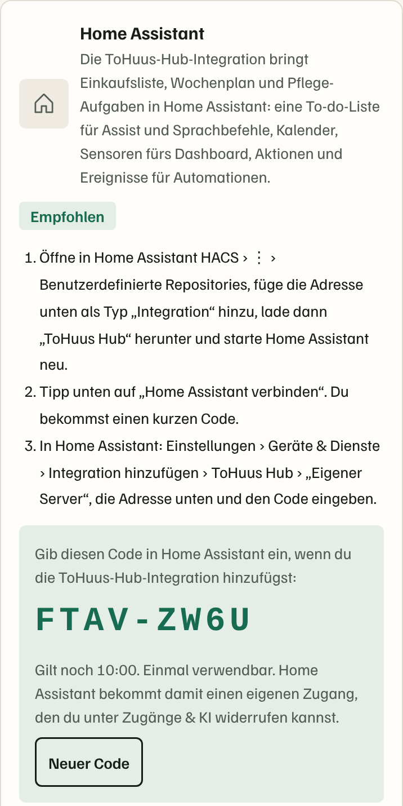

# ToHuus Hub for Home Assistant

[](https://hacs.xyz/docs/faq/custom_repositories)
[](https://github.com/tillheidrich/tohuus-hub-ha/actions/workflows/hassfest.yml)
[](https://github.com/tillheidrich/tohuus-hub-ha/actions/workflows/hacs.yml)
[](https://github.com/tillheidrich/tohuus-hub-ha/actions/workflows/tests.yml)

Brings [ToHuus](https://github.com/tillheidrich/tohuus-hub), the shopping and household assistant that remembers what is missing at home, into Home Assistant as a native integration: a real **to-do list** for the shopping list (Assist, voice, dashboards), a **calendar** for the week plan, **sensors** (due to buy, shopping list, spending), **notifications** to your notify services, **actions** for automations and **events**.

Works with **ToHuus Cloud** and with **your own ToHuus Hub** (Docker). You connect with a short **code from the ToHuus app**, no token copying. Home Assistant only connects *out* (HTTPS and a live event stream): nothing in your home has to be reachable from the internet, and no YAML, REST sensors or webhooks are needed.

## What you get

| Entity | What it shows |
|---|---|
| `sensor.tohuus_hub_due` | What ToHuus suggests buying now from your purchase rhythm (receipts and ticks), names in `items`. *0.3.0+* |
| `sensor.tohuus_hub_spending_month` / `_spending_week` | Money spent on groceries and household this month / week, with budget and what's left as attributes. *0.3.0+* |
| `select.tohuus_hub_leader_shopping` / `_meals` / `_care` | Who leads per topic when you sync with another HA list or calendar: *Both*, *Home Assistant*, *ToHuus* or *Off*. *0.3.0+* |
| `todo.tohuus_hub_shopping_list` | The shopping list, two-way: add, tick off, rename, reorder, delete – also by voice via Assist. Text is parsed like ToHuus Hub's quick add ("2 milk, bread" → two items). |
| `calendar.tohuus_hub_meal_plan` | Lunch and dinner from the week plan (all-day events). |
| `calendar.tohuus_hub_care_tasks` | Recurring care: water filter, smoke alarms, descaling … repeats are projected ahead; overdue tasks sit on today. |
| `sensor.tohuus_hub_tonight` | Tonight's planned meal (or a suggestion), with the recipe photo as entity picture. |
| `sensor.tohuus_hub_products_low` / `_products_empty` | Count, with the products as attribute `items`. |
| `sensor.tohuus_hub_expiring_soon` | Best-before soon or past. |
| `sensor.tohuus_hub_eat_first` | What should be eaten first, leftovers included. |
| `sensor.tohuus_hub_frozen_portions` | Frozen portions in labelled containers; `thaw` lists planned meals to take out of the freezer. |
| `sensor.tohuus_hub_shopping_list` | Number of open items, names as `items`. |
| `sensor.tohuus_hub_open_orders` | Open orders from the sofa or the party. |
| `sensor.tohuus_hub_care_due` / `_next_care_task` | Tasks due (list in `tasks`) / timestamp of the next one. |
| `sensor.tohuus_hub_party` | `off` or `live`, with name, end time and order counts. |
| `sensor.tohuus_hub_kid_wishes` | Wishes from kid mode waiting for a parent. |
| `sensor.tohuus_hub_receipts_to_review` | Imported receipts waiting for a check. |
| `binary_sensor.tohuus_hub_party_running`, `_something_expired` | For conditions and badges. |
| `button.tohuus_hub_check_receipt_inbox`, `_fill_week`, `_backup_now` | One tap. |
| `image.tohuus_hub_display_<n>` | Each kitchen display from ToHuus Hub (Settings › Displays) as an image, re-rendered when data changes. |
| `event.tohuus_hub_notification` | The latest ToHuus Hub notification (low stock, new order, care due …). |

Entity ids are fixed English ids so the shipped dashboards work in every language; the names you see are translated (English, German, Swedish).

Updates arrive **live**: the integration keeps a server-sent-events connection open and refreshes within a second or two of any change. If that connection drops, it falls back to polling every 60 seconds.

## Install

### HACS (recommended)

1. HACS › ⋮ › *Custom repositories* › add `https://github.com/tillheidrich/tohuus-hub-ha`, type *Integration*.
2. Search for **ToHuus Hub**, download, restart Home Assistant.

### Manual

Copy `custom_components/tohuus_hub` into your Home Assistant `config/custom_components/` folder and restart.

## Set up

1. In ToHuus (app or web): *Settings › Home Assistant* › **Connect Home Assistant**. You get a code like `ABCD-EFGH` (valid 10 minutes, works once).
2. In Home Assistant: *Settings › Devices & services › Add integration › ToHuus Hub*.
3. Choose **ToHuus Cloud** and enter the code. Or choose **Own server**, enter the address Home Assistant reaches your ToHuus Hub at (e.g. `http://192.168.1.20:8080`) and the code.



Home Assistant exchanges the code for its own access (scope "Home Assistant"). It shows up in ToHuus under *Settings › Access & AI* as "Home Assistant · <your home's name>" and can be revoked there; Home Assistant then asks for a new code. The access only works for the Home Assistant API and the live update stream – it can't read anything else.

Without a code (older ToHuus Hub): *Own server › Token instead of code*, with a token from *Settings › Access & AI › New access › Home Assistant*.

**Options** (*Configure* on the integration): switch off parts you don't need (to-do, calendars, display images, buttons, event entity), turn live updates off, choose colour / greyscale / black-and-white and size for display images, pick the Cookidoo calendar, and choose **notify services** for ToHuus notifications.

**Notifications:** pick one or more notify services (`notify.mobile_app_…`, a TV, a speaker, `notify.persistent_notification`) and which kinds (new order, run out, receipt waiting …). Home Assistant receives ToHuus notifications over its live connection and passes them on; a tap on a phone notification opens ToHuus. If ToHuus already sends notifications per person through the companion app (*Settings › Home Assistant › Notifications* in ToHuus), leave this empty, otherwise they arrive twice.

**Cloud:** the receipt inbox, backup and Cookidoo buttons/pull belong to self-hosted setups; in ToHuus Cloud they answer with a short note. Everything else works the same.

**Cookidoo week plan:** if the official *Cookidoo* integration is set up, ToHuus Hub gets the planned dishes automatically – the integration reads `calendar.cookidoo_speiseplan` (or the calendar chosen in the options) for the next 14 days and sends it to ToHuus Hub every 3 hours and whenever the calendar changes. ToHuus Hub needs no Home Assistant token for this. Switch it off in the options if you don't want it.

Requires ToHuus Hub with the v1 integration API (October 2026 or later; pairing by code and the 0.3.0 sensors from mid-October 2026) and Home Assistant 2024.12 or later.

## Already doing this in Home Assistant? (two-way bridge, 0.2.0+)

If your household already keeps its shopping list in Bring!, the built-in shopping list or Todoist, plans meals in Mealie or a local calendar, or gets messages through the companion app, nothing needs doing twice. The integration tells ToHuus Hub what Home Assistant has, and ToHuus Hub proposes per topic who leads (*Settings › Home Assistant › What does Home Assistant already do for you?*). Since 0.3.0 you can also switch it from Home Assistant with the *who leads* selects:

| Topic | Home Assistant side | Modes |
|---|---|---|
| Shopping list | any to-do list (shopping list, Bring!, Todoist, Local To-do, Cookidoo) | both ways · Home Assistant leads · ToHuus leads |
| Meal plan | calendars (Mealie, Local Calendar, a family calendar) | Home Assistant leads (import) · ToHuus leads (export) · both |
| Care tasks | a to-do list | due tasks appear there; ticking one off completes it in ToHuus Hub |
| Who is home | `person.*` | used for "who gets it" and away mode |
| Notifications | `notify.mobile_app_*` | per member instead of the browser push |
| NFC tags | `tag_scanned` | a scan runs the quick action of a ToHuus QR label (one taken, onto the list, opened, done) |
| Voice commands | entities exposed to Assist / Alexa / Google | listed with example phrases on the house info cards for babysitters and guests – names and areas only, never locks, alarms, cameras, garage doors, and never any codes |

How it works: the integration posts snapshots of the entities ToHuus Hub watches to `/api/ha/v1/bridge/sync` and runs the operations it gets back (add / update / remove to-do items, create / delete calendar events, notify), acknowledging each one. It syncs at start, every 5 minutes, when a watched entity changes and right after a change in ToHuus Hub (server-sent `bridge` event). Conflicts: the leading side wins; in "both ways" the later change wins. ToHuus Hub's own to-do and calendar entities are never used as sync targets, events it writes carry a marker so nothing bounces back, and entries marked discreet in ToHuus Hub never leave it. After a scan, `tohuus_hub_tag` (`tag_id`, `ok`, `message`) is fired so an automation can say what happened.

Turn the bridge off in the options (*Two-way sync with ToHuus Hub*) if you don't want ToHuus Hub to see your lists, calendars and people.

## Actions

All actions accept an optional `config_entry_id` if you run more than one ToHuus Hub, and return ToHuus Hub's answer when called with *response*.

| Action | Fields |
|---|---|
| `tohuus_hub.add_to_shopping_list` | `text` ("2 milk, bread") **or** `product` (name or number), optional `quantity` |
| `tohuus_hub.consume` | `product`, `quantity` (default 1) |
| `tohuus_hub.mark_used_up` | `product` – stock to zero, onto the shopping list |
| `tohuus_hub.add_stock` | `product`, `quantity`, optional `best_before` |
| `tohuus_hub.plan_meal` | `recipe` (name or number) **or** `title`, optional `date`, `slot` (`lunch`/`dinner`) |
| `tohuus_hub.order` | `product` + `quantity`, or `items: [{product, qty, options}]`, optional `note`, `name` |
| `tohuus_hub.approve_kid_wish` | `wish_id`, `approve` (false declines) |
| `tohuus_hub.complete_care_task` | `task` (name or number) |

Products are matched by name the same way ToHuus Hub matches receipts; a number (`12` or `#12`) is always exact.

```yaml
# NFC tag on the coffee jar
automation:
  - alias: Coffee beans used up
    triggers:
      - trigger: tag
        tag_id: coffee-jar
    actions:
      - action: tohuus_hub.mark_used_up
        data:
          product: Coffee beans
```

## Events

Every ToHuus Hub notification is fired on the event bus as `tohuus_hub_event`:

```yaml
event_type: tohuus_hub_event
data:
  event: order.new          # stock.low, stock.empty, stock.expiring, import.review, order.new,
  type: order_new           # order.status, shopping.added, digest.daily, care.due, party.ending, kids.wish
  title: Order from Lea
  message: 2× Cola
  url: http://tohuus.local:8080/bar
  data: { order_id: 12, guest: Lea, items: 1 }
  config_entry_id: 01J…
```

```yaml
# Flash the living room light on a new party order
automation:
  - alias: New order
    triggers:
      - trigger: event
        event_type: tohuus_hub_event
        event_data:
          event: order.new
    actions:
      - action: light.turn_on
        target: { entity_id: light.living_room }
        data: { flash: short }
```

The same notifications drive `event.tohuus_hub_notification`, so you can also pick them in the automation editor under *Entity › Event*.

## Dashboards

Ready-made dashboards are in [`dashboards/`](dashboards/):

- **`tohuus-core.yaml`** – built-in cards only. *Kitchen* view: tonight's meal with photo, eat first, shopping list (to-do card), low and empty products, care tasks, party, kid wishes. *Wall* view for a landscape tablet: clock, tonight, shopping list, the kitchen display image, a week calendar.
- **`tohuus-mushroom.yaml`** – the same with [Mushroom](https://github.com/piitaya/lovelace-mushroom) cards (install Mushroom from HACS first).

Paste the file into a dashboard's *Raw configuration editor*.

What it looks like (screenshots of the dashboards follow with the first public release, see RELEASE.md):
- *Kitchen, phone*: three stacked sections. On top the recipe photo of tonight's dinner with its name and a "Fill the week" tile; below a short "Eat first" list with days left. Middle: the shopping list as an interactive to-do card, then two tiles with running-low and run-out counts and the product names. Bottom: care tasks due, the next care date, a one-week list calendar of meals and care, party status and open orders; kid wishes and "something expired" only appear when relevant.
- *Wall, tablet*: three columns. Left: large clock, tonight's dinner with photo, five "eat first" items. Middle: the full shopping list. Right: the ToHuus Hub kitchen display picture, a glance row (low / best before / care / orders) and the week's meal plan.

## Coming from the YAML package?

The older setup (REST sensors from `/api/ha/summary`, `rest_command` and a webhook automation) keeps working, but you don't need it any more:

- Remove the `packages/tohuus.yaml` package (or the `rest:` / `rest_command:` sections you copied).
- In ToHuus Hub, turn off *Settings › Access & AI › Shopping list in Home Assistant* – the integration's to-do entity talks to ToHuus Hub directly. If you want a separate HA list (Bring!, the built-in list) kept in step, use *Settings › Home Assistant* instead: it takes over the old sync's links.
- The webhook in *Settings › Notifications › Home Assistant* is optional now – `tohuus_hub_event` delivers the same events. Keep it only if you rely on the actionable phone push from the package.

## Troubleshooting

- **"Can't reach ToHuus Hub"** – use the address Home Assistant can reach (inside Docker, `localhost` is the container itself).
- **Recipe photos don't show** – the photo is loaded by your browser from ToHuus Hub's address (`BASE_URL`). It must be reachable from where you open the dashboard.
- **"This code is not valid (any more)"** – codes last 10 minutes and work once. Tap *Connect Home Assistant* again in ToHuus.
- **"This ToHuus Hub does not know codes yet"** – update ToHuus Hub, or use *Token instead of code*.
- **Diagnostics** – *Settings › Devices & services › ToHuus Hub › ⋮ › Download diagnostics* (token, addresses, household name and notify service names are redacted).

## Licence

The integration is MIT-licensed so it fits HACS and can be copied into other setups freely. ToHuus Hub itself is AGPL-3.0.

## Development

```sh
python scripts/validate.py                       # syntax, manifest, translations, services
pip install -r requirements_test.txt
python -m pytest -q                              # config flow, pairing, entities, actions, events
```

CI runs hassfest (`.github/workflows/hassfest.yml`), the HACS action (`hacs.yml`) and the tests (`tests.yml`) on every push. Releases: see [RELEASE.md](RELEASE.md).
